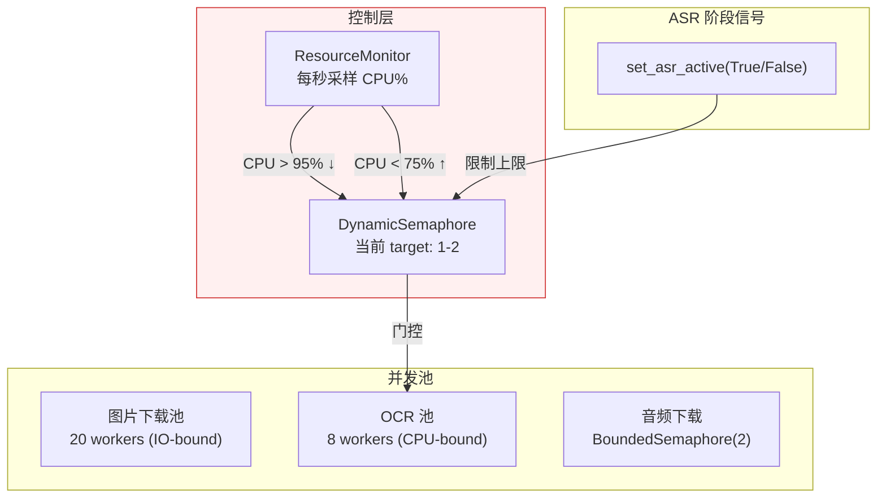
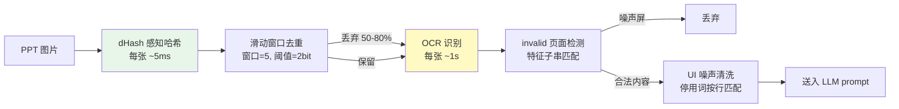

# iCourse Subscriber

通过 GitHub Actions 定时检查复旦大学 iCourse 课程录播，生成**语音转录、时间轴字幕和 PPT 文字识别结果**，将数据加密保存到你自己的 GitHub 仓库，并通过 GitHub Pages 查看。不需要自行部署服务器。

**当前默认功能：课程监控、ASR 转录、PPT OCR、加密归档和网页浏览。** AI 大模型摘要和自动发送邮件的代码仍在，但主工作流已关闭这两项功能；仅添加 API Key 或邮箱 Secret **不会**自动启用。

> [!IMPORTANT]
> 本项目仅供有相应课程访问权限的学生个人学习使用。不要把课程资料、转录文本或数据库明文传播到公开平台。请勿在树洞、班级群或其他大群中大规模转发本项目，以免给学校平台和项目带来不必要的风险。

## 开始前，先了解三个东西

| 名称 | 用途 | 要不要自己创建？ |
|---|---|---|
| `main` 分支 | 保存程序、前端和 GitHub Actions 工作流 | Fork 后就有，不用动 |
| `data` 分支 | 保存公开的课程 ID 列表和**加密**的课程数据库 | **第一次运行自动完整创建** |
| GitHub Actions Secrets | 保存学号、UIS 密码和可选的独立数据库密码 | 需要自己设置，不写进代码 |

每个 Fork 都有自己的 `data` 分支和数据库，不会读取原作者的订阅列表，也不需要填写 `COURSE_IDS` Secret。

## 五步快速开始

### 1. Fork 仓库，启用 Actions

点击右上角 **Fork**，将本项目复制到自己的 GitHub 账号。之后的操作全部在**你自己的 Fork** 中进行。

打开 Fork 的 **Actions** 页面，如果 GitHub 提示需要启用工作流，先选择启用。刚 Fork 的仓库可能不会立即执行定时任务，因此建议主动运行一次。

### 2. 配置账号与数据库密码

进入 **Settings → Secrets and variables → Actions → New repository secret**，添加：

| Secret | 必填 | 作用 |
|---|---|---|
| `STUID` | 是 | 复旦学号，供学校登录使用 |
| `UISPSW` | 是 | UIS 统一身份认证密码，供学校登录使用 |
| `DB_PASSWORD` | 建议 | **独立的数据库加密密码**，不必与学号/UIS 密码相同 |

建议给 `DB_PASSWORD` 使用密码管理器生成的强随机密码。即使不设置，程序仍能运行，但会使用基于学号和 UIS 密码派生的旧方案加密数据。

> [!WARNING]
> `data` 是公开分支，里面的课程编号也是公开的，**但录播转录与 OCR 数据以密文保存**。不要把 `STUID`、`UISPSW`、`DB_PASSWORD`、GitHub PAT 或任何邮箱/API 密钥写进仓库文件。

### 3. 第一次运行 `iCourse Check`，完成初始化

进入 **Actions → iCourse Check → Run workflow → Run workflow**，等待这次运行完成。

**任何需要读取 `data` 的工作流都会先检查数据文件是否齐全。**

- 如果完全没有 `data`，就自动创建独立的分支、`data/subscriptions.json` 和**完整的空加密 SQLite 数据库（索引及分片）**。
- 如果 `data` 已存在但缺少订阅配置或尚未生成数据库，会尝试补齐缺失文件，同时保护已有的数据。
- **只要本次创建了缺失文件，工作流就结束，不会继续登录学校或执行录播处理。** 下次运行时文件齐全，才进入正常流程。
- 如果原有加密分片已经损坏或丢失，不会用空数据库强行覆盖，需先恢复原数据。

新 Fork 创建的配置文件为：

```json
{
  "course_ids": []
}
```

此时已经有完整的**空加密数据库**，只是尚未添加课程，因此网页中暂时没有课程内容。

### 4. 在 `data` 分支填写课程 ID

从你的仓库页面切换到 **`data` 分支** → 打开 `data/subscriptions.json` → 点击编辑（铅笔图标），将课程编号填入数组，然后提交修改。例如：

```json
{
  "course_ids": [
    "40243",
    "38135",
    "37695"
  ]
}
```

如何查找课程 ID：登录 [iCourse](https://icourse.fudan.edu.cn)，进入一门自己有权限访问的课程，在课程页面地址中找到数字编号。


请使用英文双引号、英文逗号，保持 JSON 格式正确；修改完后点击 **Commit changes**。课程 ID 是普通配置，不需要存放在 Secrets 中。

### 5. 再运行一次，开始抓取课程

回到 **Actions → iCourse Check → Run workflow**，运行第二次。程序会：

1. 从你自己的 `data/subscriptions.json` 读取课程列表。
2. 使用 Secrets 登录学校 WebVPN 与 iCourse，检查有权限访问的录播。
3. 对需要处理的课次生成语音转录、时间轴字幕和 PPT OCR 结果。
4. 更新加密数据库，并写入自己仓库的 `data` 分支。

第一次初始化时，`data` 分支就已经有 `data/icourse-index.enc`、`data/shards/` 等加密文件；第二次运行才会填入真实课次数据。首次抓取可能比较耗时，取决于待处理课程数量。

默认每日北京时间 **06:00、12:00、18:00、24:00** 定时检查；也可以随时手动运行。

## 在 GitHub Pages 查看课程


1. 进入 Fork 的 **Settings → Pages**，将部署来源（Source）设为 **GitHub Actions**。
2. 打开 **Actions → Deploy Frontend → Run workflow**，部署网页。
3. 访问 `https://你的GitHub用户名.github.io/Fudan_iCourse_Subscriber/`（如果重命名了仓库，请替换路径）。
4. 在网页填写**你自己的** Repo Owner、Repo Name，以及 GitHub Personal Access Token（PAT）。
5. 若设置了 `DB_PASSWORD`，使用它解密；否则使用学号与 UIS 密码对应的旧密钥方案。

PAT 用于访问 GitHub 仓库数据：仅查看时至少要能读取 Contents；使用网页里的**订阅编辑器**保存课程列表时，需要 **Contents: Read and write**；从网页触发工作流还需要 **Actions: Read and write**。这些是 GitHub 权限，不是学校账号权限。

**网页的 Connect 并不执行学校 UIS 登录**，它只负责读取你自己仓库的密文并在浏览器中解密。完成首次初始化后即可连接空数据库；添加课程并再次运行后才会看到课次。

浏览器不会把解密后的数据库长期存储在 IndexedDB；该缓存保存的是加密数据，凭据仅保留在当前标签页会话。

## 日常使用：持久订阅与单次处理

| 操作 | 会修改 `data/subscriptions.json` 吗？ | 适合什么情况 |
|---|---|---|
| 直接编辑 `data` 分支的 JSON | **会** | 新增、移除日常监控课程 |
| 网页订阅编辑器「保存订阅」 | **会** | 已有数据库后，用网页管理课程 |
| `iCourse Check` | 不会修改课程列表 | 按订阅检查与处理新录播 |
| `Single Run` 输入课程 ID | **已有配置时不会** | 临时运行不在订阅列表里的课程 |

`Single Run` 也能用于首次安装：**如果 Fork 尚无 `data` 分支**，第一次填写课程 ID 会创建完整数据分支、加密空数据库并保存初始订阅，**然后结束本次运行**。再次运行才开始处理课程。如果已通过 `iCourse Check` 初始化，请直接编辑 JSON，才能让新课程成为**长期订阅**。

两种工作流不需要 `COURSE_IDS` Secret。`Single Run` 的课程输入仅在该次运行时有效，不能用来替代已存在的持久订阅配置。

## 可选功能：AI API 与邮箱

当前主流程**只执行 ASR 与 OCR**。相关功能没有被删除，但是否自动运行取决于程序本身，而不只是有没有设置 Secret：

| 功能 | 现在能否使用？ | 需要什么？ |
|---|---|---|
| SenseVoice ASR / PPT OCR | 默认启用 | 不需要第三方大模型 API Key |
| 大模型生成课程摘要 | **自动执行已关闭** | `src/ai/summarizer.py` 保留，重新接入主流程才会调用 API |
| 处理完成后自动发送摘要邮件 | **自动执行已关闭** | `src/api/emailer.py` 保留，重新接入主流程才会发信 |
| 手动导出已有课程摘要并邮件发送 | 保留 | `Export Course Summaries` 工作流、已有摘要和 SMTP 配置 |

可供摘要模块使用的配置有 `DASHSCOPE_API_KEY`（ModelScope）、`DEEPSEEK_API_KEY`（DeepSeek）、`GEMINI_API_KEY`（Gemini）；提供商及模型列表在 `src/runtime/config.py` 中。**当前仅填写这些 Secrets 不会触发摘要。**

如果需要使用手动邮件导出，配置 `SMTP_EMAIL`（发件邮箱）、`SMTP_PASSWORD`（SMTP 授权码）、`RECEIVER_EMAIL`（收件邮箱），以及可选的 `SMTP_HOST` / `SMTP_PORT`。默认 SMTP 服务器为 `smtp.qq.com:465`，其他邮箱请填写对应 SMTP SSL 服务器。由于当前主流程不产生新的 AI 摘要，**新安装的数据库通常没有可供该导出工作流发送的摘要**。

## 旧用户升级与数据库密码更换

- **从 `COURSE_IDS` Secret 迁移**：现在订阅清单以 `data/subscriptions.json` 为准。旧数据库若在元数据中保存过订阅课程，工作流可以尝试迁移；没有记录时请手动创建/编辑这个 JSON。确认配置已保存后，再删除旧 `COURSE_IDS` Secret。
- **改用独立数据库密码**：在 Actions Secrets 新增 `DB_PASSWORD`（不要删除学校登录使用的 `STUID` / `UISPSW`），手动运行一次未勾选 `probe_only` 的 `iCourse Check`，成功后网页改用新的数据库密码连接。
- **轮换独立数据库密码**：新密码写入 `DB_PASSWORD`，旧密码暂时写入 `DB_PASSWORD_PREVIOUS`，完成一次重加密并验证后删除后者。

无法正确解密旧数据库时，程序应报错而非静默丢弃数据；因此修改数据库密码前请确认旧密码仍可用。需要解密同一云端数据的本地工具也必须使用匹配的 `DB_PASSWORD`。

## 常见问题

**第一次运行结束，为什么没有课程记录？**

正常。首次运行只负责初始化 `data` 分支、课程配置与空加密数据库；在 `data` 分支添加课程，再运行一次 `iCourse Check` 才会抓取课程。旧版本若只留下 `subscriptions.json`，新版工作流会先补建数据库，并在下一次运行进入正常处理。

**为什么没有自动创建 `data`，或者工作流提示 HTTP 403？**

确认运行的是更新后的 `main`，并且是在**自己的 Fork** 中运行。先到 Actions 页面启用工作流；再检查 **Settings → Actions → General → Workflow permissions** 是否允许工作流写入仓库内容。组织策略可能额外限制权限。

**课程 ID 填好了，但没有找到课次？**

确认 ID 是课程页面的编号、对应账号有访问权限，并查看 Actions 运行日志。第一次处理需要等待数据发布结束；没有回放的课次也不会凭空生成转录。

**网页 Connect 报错或者显示了别人的仓库？**

确认 Repo Owner / Repo Name 指向自己的 Fork，`data` 分支已产生数据库，并使用正确的数据库密码。查看自己仓库需要匹配其 GitHub PAT 权限，**不要直接拿原作者的 Pages 地址作为自己数据的入口**。

**为什么设置了大模型 API Key 或邮箱，仍然没有摘要/邮件？**

因为自动摘要与自动邮件目前在主程序中关闭。这并非配置错误，也不是 `data` 分支初始化失败。

**Fork 后上游项目更新了怎么办？**

在自己仓库的 `main` 分支通过 **Sync fork → Update branch** 同步程序代码；`data` 分支是个人数据，**不要用上游的 `data` 覆盖自己的配置和加密数据库**。


> [!CAUTION]
> **合规与账号安全提醒**
>
> 请遵守学校平台的使用规范及适用的著作权要求，仅在本人获授权访问的范围内用于个人学习。不要未经许可复制、下载、二次分发课程资源，也不要把解密后的转录文本、OCR 内容或数据库明文公开传播。
>
> GitHub Actions 主流程不以保存原始录播视频为目的；仓库中另有本地工具，但使用者仍须自行确认具体操作获得授权。网页查看器会在本地解密课程数据库，这是项目的正常功能，不代表允许公开明文。
>
> 本项目通过 WebVPN 自动登录学校账号，可能受到学校账号风控或平台策略调整影响。请妥善管理 Secrets 和数据库密码；运行造成的账号或使用风险由使用者自行评估。


---

## 技术说明

> 以下部分是对本项目技术细节和设计的讨论，欢迎感兴趣的技术读者阅读。

### 调度器：CPU 反馈闭环

OCR 和 ASR 是两个 CPU-bound 工作负载，在 4 核 GitHub Actions runner 上需要共享算力。RapidOCR 每处理一页 PPT 图片约需 1 秒，保持单核 100% 占用；sherpa-onnx ASR 使用 4 线程 ONNX 推理，需要多核。ASR 的优先级高于 OCR——转录延迟会导致音频流中断。

动态信号量：标准库 BoundedSemaphore 不支持在运行时调整并发上限。DynamicSemaphore 在线程安全的基础上增加了 `set_target(n)` 方法，允许在运行时调高/调低并发目标。正在执行的 worker 不受影响（自然结束后不再补充），等待中的 worker 在 target 上调时被唤醒。

资源监控：ResourceMonitor 每秒采样 `psutil.cpu_percent()`，执行迟滞判断（hysteresis control）：当 CPU > 95% 且 target 尚未到达下限时递减 OCR 并发；当 CPU < 75% 且 target 尚未到达上限时递增。双阈值（95%/75%）制造了一个 20% 宽的死区（deadband），避免系统在单个阈值附近震荡。这套逻辑本质上是一个 bang-bang 控制器。



OCR_MAX_TARGET 设为 2 而非 8 的原因是：实际运行数据表明，RapidOCR 在 4 核机器上从未超过 2 个并发 worker——其余核心被 ASR 的 4 线程 ONNX 推理占满。更高的 target 仅导致 ResourceMonitor 频繁调整目标值，对吞吐无贡献。

ASR 阶段通过 `set_asr_active(True/False)` 向调度器主动声明状态。这是一个简单的布尔标志位，不需要细粒度的上下文切换，因为 ASR 和 OCR 是两个完全独立的阶段——ASR 运行时没有 OCR 依赖，反之亦然。

音频下载器使用 `BoundedSemaphore(2)` 限制并发 ffmpeg 数量。2 是理论最小值：当前转录课次需要一路，预取课次需要另一路。在 runner 的网络带宽下，两路 ffmpeg 公平共享带宽，各获得约 10 MB/s，远高于 ASR 消费速率。

### 语音识别：后处理优于更好的模型

该模块经历了 SenseVoice → FireRed → SenseVoice 的三次选择。FireRed 的转录文本更"干净"（纯中文 + 英文，无跨语种污染），但 SenseVoice 的实时倍率约 25x，FireRed 仅约 6x。在 348 节课的批量场景中，FireRed 的 ASR 总时长为 2h41m，SenseVoice 降至约 37m。当将两种模型的输出分别输入 DeepSeek-V4-Pro 生成摘要时，LLM 的摘要质量差异不显著——LLM 自动忽略了 SenseVoice 混入的日语假名和韩语谚文。

最终选择 SenseVoice 并附加后处理。后处理函数在每条 ASR segment 加入 segments 列表前执行多级清洗：删除日语假名和平假名/片假名 Unicode 区块、删除韩语谚文 Unicode 区块、删除英文 filler word 白名单（yeah, okay, uh, um, hmm 等）、删除 `<sil>` 和 `<|zh|>` 等 bracket token。技术英文（CNN, YOLO, Transformer）通过 `\b` 单词边界匹配不受影响。

每条清洗规则都经过 7 节课 × 5 门课的真实 OCR 数据验证。选择保留"well"——"well-defined"、"well-known"在技术英文中合法。

VAD 参数调优：Silero VAD 的默认 `min_silence_duration=0.25s` 在课堂场景中将老师的换气、翻页、停顿都切分为独立片段。每个片段需要一次 ASR decode，且 SenseVoice 在短片段（2-3s）上的语言检测倾向于误判为日语（因为缺乏上下文）。将参数调至 0.8s，并将 `max_speech_duration` 设为 30.0s（匹配 SenseVoice 训练感受野）。片段数量减少约 60%，日语误判率大幅下降。

### PPT 流水线：计算成本驱动的去重策略

iCourse 录播系统每 20-30 秒截取桌面截图。90 分钟课程产生约 200-300 张图片，其中大量是同一张幻灯片的重复截图。直接 OCR 全部图片将浪费大量计算时间和 LLM prompt token 预算。

去重采用两阶段策略：先以 dHash 感知哈希做粗筛，再以 OCR 文本分类做精筛。dHash 的计算成本约每张几毫秒，而 OCR 约每张 1 秒——因此在 OCR 之前执行。



滑动窗口去重有一个关键实现细节：已丢弃的页面不成为锚点。防止级联效应——如果第 1 页与第 3 页相似（第 3 页被丢弃），第 2 页与第 4 页相似但第 1 页与第 4 页无关，我们不希望第 1 页引发第 3 页被丢弃后，第 3 页又作为锚点引发第 4 页被丢弃。

OCR 之后执行 invalid 页面检测：通过特征子串匹配（约 20 条模式，如"请不要关闭设备""cfdfudaneducn""智慧教学资源平台使用规范"）识别教室桌面壁纸和 iCourse 资源平台启动页。归一化去掉所有非字母数字字符以容忍 OCR 轻微变异。

PPT 功能区 UI 噪声清洗：PowerPoint 功能区标签（"文件""开始""插入""设计"……）每次截图都被 OCR 识别，占用了 8-18% 的 LLM prompt token。清洗采用按行精确匹配策略，而非子串匹配——例如"选择"在功能区是按钮，在生物学"自然选择"中是正常文本。功能区标签在截图中独占一行，而同一词汇出现在课程内容中时周围有其他文字。100+ 条停用词在 7 节课 × 5 门课数据中零误删。

### 数据库持久化：三环境兼容的加密 + 内容寻址分片

GitHub Actions 每次在全新容器中运行，无法依赖本地文件系统持久化。解决方案是独立的 `data` 分支，每次运行结束时加密推送数据库，下次运行时拉取解密。

AES-256-CBC + PBKDF2 加密方案需要在 GitHub Actions、Python（pycryptodome）和浏览器前端（Web Crypto API）之间兼容。`crypto_box.py` 和 `frontend/js/crypto.js` 使用相匹配的 Salted__ 格式、PBKDF2 迭代次数与 AES-256-CBC 模式。配置独立的 `DB_PASSWORD` 时，先以 `sha256("ICSdb:" + DB_PASSWORD)` 派生密码材料，再使用 PBKDF2；未配置时使用兼容旧版本的 `sha256("ICSv2:" + stuid + ":" + uispsw)` 方案。

分片的动机是增量传输。数据库约 20MB，通过 GitHub API 完整拉取会显著增加前端加载时间。按课程分组切割为 ~10MB 的 shard，每个独立加密。前端使用 git blob SHA 作为缓存键存储于 IndexedDB，未变化的 shard 自动跳过网络下载、解密、解压。

并发合并策略：两个 workflow 可能并行执行并同时写入数据库。`merge_db.py` 采用 field-level COALESCE——非空覆盖空、版本号取 MAX、错误字段在成功处理后清零。此策略是 CRDT（Conflict-Free Replicated Data Type）的简化版本，不能解决所有冲突（例如两个 workflow 对同一字段的并发写入），但在实际场景中，同一 lecture 不会被两个 workflow 同时处理，因此冲突概率足够低。

Schema 迁移：新增列时，旧的 shard 与新的 schema 之间存在列数不匹配的兼容性问题。`_migrate_shard_schema()` 在 INSERT 之前对每个 attached shard 执行 PRAGMA table_info 差集检查并通过 ALTER TABLE ADD COLUMN 补齐，将 schema 迁移与 shard 管理解耦。

### 前端：在静态页面中解密远程数据库

前端是运行在 GitHub Pages 上的纯静态单页应用，无后端服务器。它通过 GitHub API 读取 `data` 分支的加密 shard，在浏览器中使用 Web Crypto API 解密，并利用 sql.js（SQLite WebAssembly 编译）在内存中构建数据库。

解密使用的 `DB_PASSWORD`（或兼容旧库所需的 STUID + UISPSW）经密钥派生后用于浏览器本地解密，不作为学校登录请求发送。GitHub PAT 则只用于访问你自己的 GitHub 数据及触发有权限的工作流。

订阅编辑器直接读写当前 Fork 的 `data/subscriptions.json`。列表可读取、可修改，且即使未产生新录播，新增的课程也会在下一次定时巡检中被检查。旧版本的加密数据库元数据只作为一次性迁移来源；浏览器不再依赖 localStorage 猜测 Secret 的当前内容。由于后台更新数据库时会重建数据分支，发布脚本会在推送前读取并保留最新的订阅 JSON，并检查分支版本以防覆盖同时发生的网页编辑。

### 技术方法总结

- **控制理论**：ResourceMonitor 的双阈值迟滞比较器（deadband control），防止在单个阈值附近震荡。
- **排队论**：DynamicSemaphore 的可调整并发池，系统过载时减少服务窗口，负载下降后恢复。不影响正在服务的 worker，只影响等待队列。
- **CRDT 思想**：merge_db.py 的 field-level COALESCE，最终一致的并发合并策略。
- **内容寻址存储**：前端以 git blob SHA 为 shard 缓存键，相同内容产生相同 SHA 的特性直接复用。
